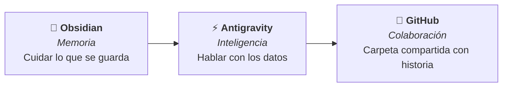
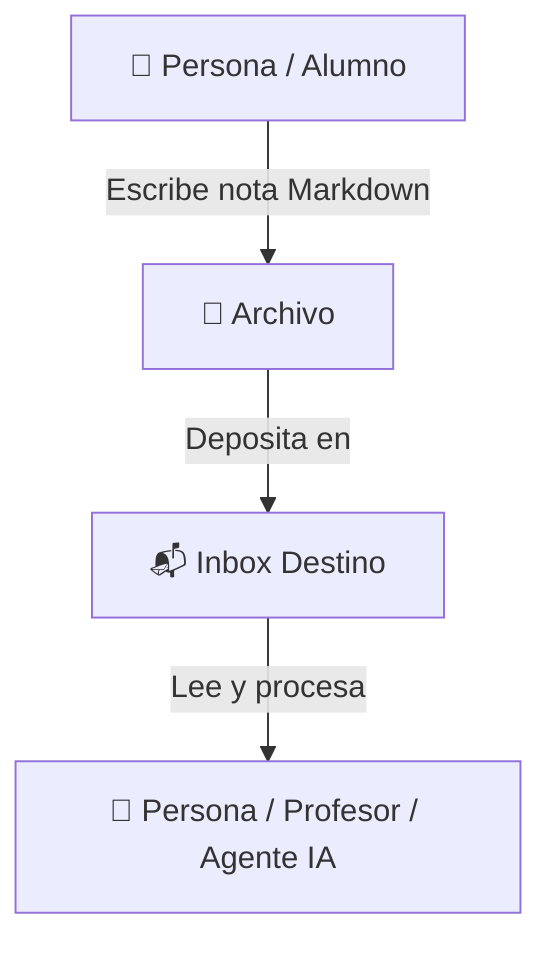

# 🏛️ Diseño del Sistema Compartido de Conocimiento — MUGRF (Sesión 1)

> **Sesión de Gimnasia Cognitiva con GPT**  
> 🗓️ **Fecha:** Sábado, 3 de octubre de 2026  
> ⏱️ **Duración:** ~7 minutos de conversación efectiva  
> 🎯 **Objetivo:** Diseñar la experiencia pedagógica y la infraestructura para la sesión inaugural de 60 minutos al inicio del Máster Universitario en Gestión de Riesgos Financieros (MUGRF).

---

> [!IMPORTANT] Tesis Pedagógica Central
> **Esta sesión NO es una clase técnica sobre herramientas.**  
> No se trata de enseñar *Obsidian*, ni *Antigravity*, ni *GitHub*. Se trata de **fundar la memoria compartida del Máster** desde la primera tarde del curso. Las herramientas son únicamente las piezas utilizadas para construir la infraestructura colectiva.



---

## 1. 🎯 Punto de Partida: Superar el Enfoque Instrumental

La idea inicial era relativamente convencional:
> *«Utilizar una hora de clase para enseñar Obsidian + Antigravity + GitHub.»*

Sin embargo, durante la reflexión la idea evolucionó de forma radical:
- ❌ **No se trata de enseñar Obsidian.**
- ❌ **No se trata de enseñar Antigravity.**
- ❌ **Ni siquiera se trata de enseñar GitHub.**
- ✅ **Se trata de crear, durante la primera tarde del Máster, la infraestructura compartida de conocimiento** que acompañará al grupo y al claustro durante todo el curso académico.

Las herramientas son medios, nunca el fin.

---

## 2. 🧱 La Tríada Conceptual: Orden y Sentido

El orden de presentación es metodológicamente riguroso:

$$\text{Obsidian (Memoria)} \longrightarrow \text{Antigravity (Inteligencia)} \longrightarrow \text{GitHub (Colaboración)}$$

### 🧠 A. Obsidian = Memoria Soberana
* La primera preocupación debe ser **qué guardamos y cómo lo guardamos**.
* La IA puede procesar, relacionar, resumir o generar información; pero si la memoria sobre la que opera está desordenada, contaminada o vacía, la capacidad posterior del sistema se degrada.
* **Principio rector:** *«Lo importante es cuidar la memoria.»* La IA no sustituye la gestión de la información; se apoya sobre ella.

### ⚡ B. Antigravity = Inteligencia sobre la Memoria
* Los alumnos podrían realizar manualmente muchas operaciones sobre los archivos. La IA no cambia necesariamente qué puede hacerse, sino que transforma radicalmente:
  1. La **velocidad** de procesamiento.
  2. La **fricción cognitiva**.
  3. La **capacidad de búsqueda semántica** y síntesis.
  4. La facultad de **descubrir conexiones no evidentes**.
  5. La posibilidad de **hablar directamente con la información**.

> [!TIP] Frase de Aula para Romper la Fricción
> > *«Hoy solo vamos a compartir conocimiento y vamos a hablar con la máquina.»*  
> Una formulación simple para disolver desde el minuto uno el miedo técnico.

### 📂 C. GitHub = Desmitificar la Carpeta Compartida
* Hay que evitar a toda costa presentar GitHub como un territorio exclusivo de desarrolladores de software.
* **Definición funcional para la sesión:**
  > *«Un repositorio de GitHub es, para lo que vamos a hacer hoy, una carpeta compartida con memoria histórica.»*
* **Cero barreras de entrada:** No necesitan aprender Git, ni comandos de consola, ni ramas (*branches*), ni *pull requests*, ni CI/CD.
* **Promesa inicial:** *«Hoy no vamos a tocar código. Solo vamos a compartir conocimiento.»*

---

## 3. 🛡️ La Conexión con la Gestión de Riesgos

> [!NOTE] ¿Qué tiene que ver esto con un Máster en Riesgos Financieros?
> > **«Es información. Cuanta más y mejor información tengas, mejor vas a gestionar el riesgo.»**

La gestión de riesgos consiste fundamentalmente en navegar el ciclo:

$$\text{Información} \longrightarrow \text{Incertidumbre} \longrightarrow \text{Toma de Decisiones}$$

Por tanto, esta sesión no es una digresión tecnológica en el programa: es la construcción en vivo del soporte cognitivo necesario para capturar señales, clasificar datos, compartir análisis y decidir con fundamento.

---

## 4. 📝 Actividad Previa y Ficha del Alumno

Antes de entrar en el aula, los alumnos deben disponer de:
1. Una cuenta activa en **GitHub**.
2. Un perfil profesional en **LinkedIn**.
3. Remitir su usuario de GitHub para ser dados de alta como colaboradores del repositorio.

Cada alumno tendrá una ficha dentro del sistema con formato atómico:

```markdown
# [Nombre del Alumno]

- **GitHub:** @usuario
- **LinkedIn:** https://linkedin.com/in/usuario
- **Área de interés / Foco en Riesgos:** ...
```

> [!INFO] Cultura de Transparencia
> No se recopila información privada. Forma parte deliberada de un **laboratorio compartido y visible**. Desde el día 1, el alumno deja de ser un consumidor pasivo de clases para convertirse en un **nodo activo** de la red de inteligencia del Máster.

---

## 5. 🗂️ Arquitectura Mínima del Repositorio

No conviene arrancar con hiperarquitecturas ni decenas de subcarpetas vacías. El árbol de partida es deliberadamente sobrio:

```text
MUGRF-2026-27/
│
├── README.md                      # Manifiesto y guía de bienvenida
│
├── alumnos/                       # Espacio individual de la promoción
│   ├── luis_garvia/
│   │   ├── README.md
│   │   └── inbox/
│   ├── Alumno_01/
│   │   ├── README.md
│   │   └── inbox/
│   └── Alumno_02/
│       ├── README.md
│       └── inbox/
│
└── compartido/                    # Recursos, datasets y marcos comunes
```

> **Regla de oro:** La estructura debe crecer de forma orgánica a medida que surjan necesidades reales en las clases.

---

## 6. 📬 La Pieza Maestra: Un Inbox para Cada Persona

La innovación más potente de este diseño reside en dotar a cada participante de su propia bandeja de entrada:

```text
alumnos/[nombre]/inbox/
```

Esto transforma el repositorio de mero almacén estático a un **sistema vivo de mensajería y coordinación**:



> [!QUOTE] Regla de Interacción Fricción Cero
> > *«¿Quieres decirle o dejarle algo a alguien? Mételo en su Inbox.»*

* Un alumno puede depositar un apunte en el Inbox de un compañero.
* Un profesor puede dejar feedback personalizado en el Inbox de un estudiante.
* Un estudiante puede formular una consulta en el Inbox del director.
* **El salto agéntico:** Un agente de IA puede leer y responder en esas mismas bandejas. El archivo Markdown se consolida como el protocolo universal de entendimiento entre humanos y modelos.

---

## 7. 🔄 Invertir el Orden Tradicional del Máster

| Modelo Tradicional | Propuesta MUGRF 2026-2027 |
| :--- | :--- |
| 1. Explicación de contenidos teóricos | **1. Se funda la memoria compartida (Día 1)** |
| 2. Realización de ejercicios individuales | 2. El curso se desarrolla *dentro* del sistema |
| 3. Entrega de trabajos en buzones cerrados | 3. Los contenidos y debates se decantan en notas |
| 4. Proyecto final de máster (TFM) | 4. Las experiencias enriquecen el repositorio |
| 5. *Al final (si acaso):* recopilación compartida | **5. Resultado: el Máster es el repositorio vivo** |

> [!IMPORTANT] Principio Rector de Inversión
> > **«No construimos el repositorio como resultado final del Máster. Construimos el Máster dentro del repositorio desde el primer minuto.»**

---

## 8. 🎖️ El Rol del Director y la Arquitectura Fractal

* **Perspectiva de Dirección:** Luis no entra aquí como profesor de una materia aislada, sino como director del Máster. Tiene la legitimidad para establecer una infraestructura intelectual transversal a todas las asignaturas.
* **Naturaleza Fractal:** El patrón se replica en todas las escalas:

$$\text{Sistema Personal} \;\Longrightarrow\; \text{MUGRF} \;\Longrightarrow\; \text{Asignatura} \;\Longrightarrow\; \text{Equipo} \;\Longrightarrow\; \text{Persona}$$

Lo que funciona en el sistema personal se prueba en el MUGRF; lo que madura en el MUGRF se extiende a las aulas universitarias.

---

## 9. 🚀 Resultados Concretos tras los 60 Minutos

Al término de la sesión inaugural de una hora, la promoción debe haber alcanzado:

- [x] **1. Repositorio común funcionando en GitHub.**
- [x] **2. El 100% de los alumnos dados de alta y censados.**
- [x] **3. Espacio y carpeta individual creada para cada participante.**
- [x] **4. Un `inbox/` operativo por persona, incluido el director.**
- [x] **5. Al menos una aportación o archivo real creado por cada alumno.**
- [x] **6. El repositorio abierto localmente desde Obsidian.**
- [x] **7. Antigravity interrogando y operando sobre esa memoria.**
- [x] **8. Conciencia compartida de que este espacio crecerá con ellos todo el año.**

---

## 10. 🛡️ Lo que NO Necesitan Aprender el Lunes

Para garantizar el éxito y evitar la sobrecarga cognitiva, **se elimina deliberadamente todo esto**:

* 🚫 **Nada de comandos Git por consola.**
* 🚫 **Nada de teoría de ramas (*branches*) ni fusiones (*merges*).**
* 🚫 **Nada de sintaxis compleja de programación.**
* 🚫 **Nada de configuración avanzada de modelos ni RAG.**
* 🚫 **Nada de intentar ser expertos en Obsidian el primer día.**

Solo necesitan asimilar una secuencia elemental:

$$\text{Creamos información} \longrightarrow \text{La guardamos} \longrightarrow \text{La compartimos} \longrightarrow \text{La máquina trabaja sobre ella}$$

---

## 11. 💎 Síntesis y Frases Fuerza

> [!QUOTE] Frase Brújula para la Pizarra
> > **«No vamos a aprender Obsidian, Antigravity ni GitHub. Vamos a crear la memoria del Máster y después vamos a enseñar a la máquina a trabajar con ella.»**

> [!QUOTE] La Ambición del Programa
> > **«Otros programas terminan el Máster creando un proyecto compartido. Nosotros vamos a empezar por él.»**

---

## 🧭 Conexiones del Vault

- **Módulo Académico:** `00 Área operativa/01 Asignaturas/` · `07 MUGRF`
- **Diario de Sesión:** [[00 Área operativa/02 Inbox/Notas diario|Notas de diario (03-oct-2026)]] · [[2026_10_04_Diario del Proyecto Aprendizaje. Entrada 89|Entrada 89 del Diario]]
- **Protocolo de IA:** [[_AGENT_PROTOCOL|Contrato Único de Agentes]]
